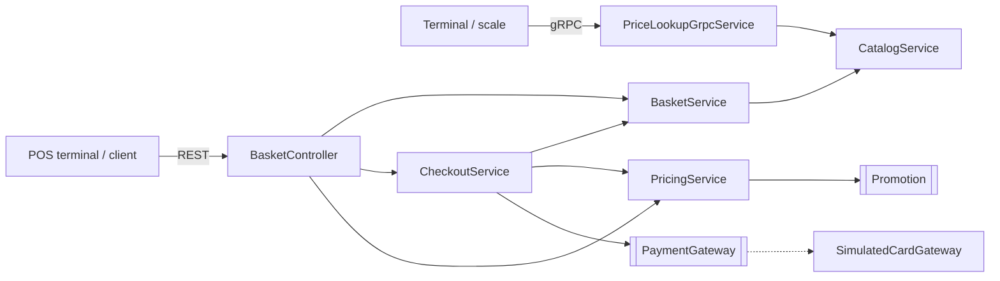
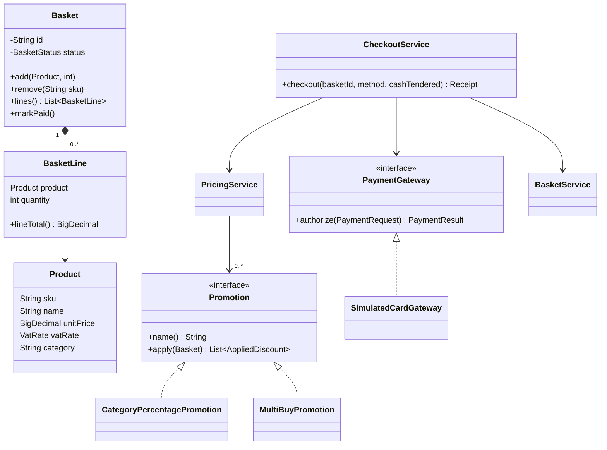
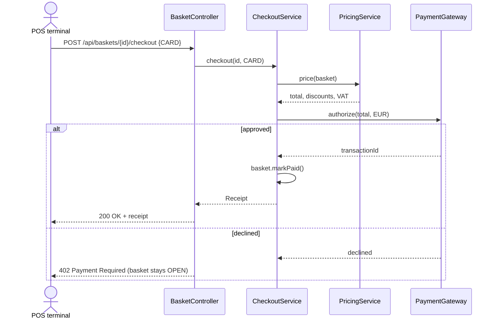

# Retail POS Checkout Service

[](https://github.com/rutuldalsaniya/retail-pos-checkout/actions/workflows/ci.yml)

A point-of-sale (POS) backend for a grocery store till, built with **Java 21** and **Spring Boot 3**. It covers the core of a retail sale: scanning articles into a basket, applying promotions, calculating German VAT, taking card or cash payment and issuing a receipt. The checkout is exposed as a **REST API**, and a **gRPC** price-lookup service is available for terminals and scales.

> **Kurzbeschreibung (DE):** Kassensystem-Backend (POS) für den Einzelhandel mit Java 21 und Spring Boot 3: Warenkorb, Aktionen (z. B. 3 für 2, -10 % auf Backwaren), MwSt.-Aufschlüsselung (7 % / 19 %), Kartenzahlung über eine austauschbare Payment-Schnittstelle sowie Barzahlung mit Wechselgeld. REST-API und gRPC-Preisabfrage, getestet mit JUnit 5 und Mockito, Design dokumentiert mit UML.

## Features

- **Basket handling:** open a basket, scan articles (repeated scans increase the quantity), remove articles
- **Promotions:** pluggable `Promotion` interface with two implementations
  - category discount, e.g. *Bakery -10%*
  - multi-buy, e.g. *Chocolate 3 for 2*
- **German VAT:** gross prices with a 7 % / 19 % VAT breakdown, calculated *after* discounts
- **Payment:** card payment through a `PaymentGateway` port (simulated provider with a card limit) and cash payment with change calculation. A basket is only marked as paid after a successful payment.
- **REST API** with validation and RFC 7807 problem responses (404, 409, 402, 400)
- **gRPC** `PriceLookupService` for fast price lookups by SKU
- **Tests:** JUnit 5 (incl. parameterised tests), Mockito, Spring MockMvc slice tests and an end-to-end checkout test
- **CI:** GitHub Actions builds and runs all tests on every push

## Tech stack

Java 21 · Spring Boot 3.2 (Web, Validation) · gRPC / Protocol Buffers · Maven · JUnit 5 · Mockito · AssertJ · PlantUML / Mermaid · GitHub Actions · Docker

## Architecture



The checkout logic depends only on the `PaymentGateway` and `Promotion` interfaces. A real payment provider or new promotion types can be added without changing `CheckoutService` or `PricingService`, and both services are unit-tested in isolation with mocks.

### Class diagram



### Card checkout sequence



PlantUML sources of the diagrams are in [`docs/uml`](docs/uml).

## REST API

| Method | Path | Description |
|---|---|---|
| `GET` | `/api/products` | List all articles |
| `GET` | `/api/products/{sku}` | Get one article |
| `POST` | `/api/baskets` | Open a new basket |
| `GET` | `/api/baskets/{id}` | Basket with subtotal, discounts, total and VAT |
| `POST` | `/api/baskets/{id}/items` | Scan an article `{ "sku": "4001", "quantity": 3 }` |
| `DELETE` | `/api/baskets/{id}/items/{sku}` | Remove an article |
| `POST` | `/api/baskets/{id}/checkout` | Pay `{ "paymentMethod": "CARD" }` or `{ "paymentMethod": "CASH", "cashTendered": 10.00 }` |

Example receipt:

```json
{
  "receiptNumber": "R-3F9A1C2B",
  "subtotal": 7.36,
  "discounts": [
    { "name": "Bakery -10%", "amount": 0.35 },
    { "name": "Chocolate 3 for 2", "amount": 1.29 }
  ],
  "total": 5.72,
  "vat": { "7%": 0.37 },
  "paymentMethod": "CASH",
  "change": 4.28
}
```

More request examples: [`api-examples.http`](api-examples.http)

## gRPC

Service definition: [`src/main/proto/price_lookup.proto`](src/main/proto/price_lookup.proto). The server runs on port `9090`.

```bash
grpcurl -plaintext -proto src/main/proto/price_lookup.proto \
  -d '{"sku":"4001"}' localhost:9090 pos.PriceLookupService/GetPrice
```

## Run it

Requirements: JDK 21 and Maven.

```bash
mvn verify                 # build and run all tests
mvn spring-boot:run        # REST on :8080, gRPC on :9090
```

With Docker:

```bash
mvn package
docker build -t retail-pos-checkout .
docker run -p 8080:8080 -p 9090:9090 retail-pos-checkout
```

## Tests

| Test | What it covers |
|---|---|
| `PricingServiceTest` | subtotal, merged scans, 3-for-2 (parameterised), category discount, VAT after discounts |
| `CheckoutServiceTest` | card approved / declined, cash change, insufficient cash, empty and already-paid baskets. The payment gateway is mocked with **Mockito** |
| `BasketControllerTest` | REST layer with `@WebMvcTest`: status codes, validation, error responses |
| `PriceLookupGrpcServiceTest` | gRPC reply and `NOT_FOUND` handling |
| `CheckoutFlowIntegrationTest` | full sale through the Spring context: open basket, scan, pay cash, double-payment protection |

## Design decisions

- **`BigDecimal` for money**, rounded to 2 decimals with `HALF_UP`, never `double`
- **Gross prices**, as on German shelf labels. VAT is derived per rate as `gross × rate / (100 + rate)`.
- **Discounts carry their VAT rate**, so the VAT breakdown stays correct after promotions
- **Payment before state change:** the basket is marked as paid only after the payment succeeded
- **Injected `Clock`**, so receipt timestamps are deterministic in tests

## Possible extensions

Persistence (PostgreSQL + Spring Data JPA), a real payment terminal integration (e.g. ZVT/OPI protocols), returns and voids, and a Flutter till front end using the REST API.

---

Author: **Rutul Dalsaniya** · [LinkedIn](https://www.linkedin.com/in/rutul-dalsaniya)
